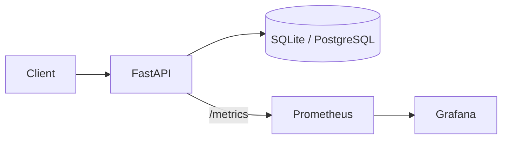

# B2B Procurement Marketplace

**Status: v0.1, in progress**

A small backend for B2B procurement: buyers search a supplier catalogue with quantity-tiered pricing, then raise Requests for Quotation (RFQs). Suppliers respond with quotes and the buyer awards one.

- Product discovery: keyword, category, supplier, price range, in-stock filters, sorting, keyset pagination
- Tiered pricing with MOQ enforcement (pure, unit-tested function in `app/pricing.py`)
- RFQ and quote workflow with an explicit state machine (invalid transitions return 409)
- Prometheus metrics and a provisioned Grafana dashboard

## Architecture



State machines: RFQ `open -> quoted -> awarded | closed` (`open -> closed` also allowed); Quote `submitted -> accepted | rejected`. Accepting a quote rejects all other submitted quotes on that RFQ and awards the RFQ.

## API

| Method | Path | Description |
|---|---|---|
| GET | `/products` | Search. Params: `q`, `category`, `supplier`, `min_price`, `max_price`, `in_stock`, `sort` (`price`, `price_desc`, `name`, `newest`), `limit`, `cursor` |
| GET | `/products/{id}` | Product with price tiers |
| GET | `/products/{id}/price?qty=N` | Unit price and line total for a quantity (422 below MOQ) |
| POST | `/rfqs` | Create RFQ; every line is validated against MOQ |
| GET | `/rfqs/{id}` | RFQ with items and quotes |
| POST | `/rfqs/{id}/quotes` | Supplier submits a quote (unit price per line) |
| POST | `/quotes/{id}/accept` | Accept quote, reject others, award RFQ |
| POST | `/quotes/{id}/reject` | Reject a submitted quote |
| POST | `/rfqs/{id}/close` | Close RFQ, rejecting open quotes |
| GET | `/health`, `/metrics` | Liveness, Prometheus metrics |

Pagination uses a keyset cursor over `(sort column, id)`, so pages have no duplicates or gaps even with ties.

## Run

```bash
python -m venv .venv && source .venv/bin/activate   # Windows: .venv\Scripts\activate
pip install -e ".[dev]"
python -m scripts.seed          # 1,000 deterministic products with tiers
uvicorn app.main:app --reload   # http://localhost:8000/docs
```

Set `DATABASE_URL` for PostgreSQL (see `.env.example`). Tables are created on startup with `create_all`.

Full stack (API, Postgres, Prometheus, Grafana):

```bash
docker compose up --build
# API :8000, Prometheus :9090, Grafana :3000 (admin/admin)
```

## Tests

```bash
pytest -q
```

42 tests: pricing unit tests, search scenarios against the 1,000 seeded products, and the RFQ/quote state machine. CI runs them against PostgreSQL 16. Tests use `DATABASE_URL` if set, otherwise a temporary SQLite file.

## Roadmap

- Alembic migrations
- PostgreSQL full-text search with a GIN index
- JWT authentication and roles (buyer / supplier / admin)
- Purchase orders from awarded quotes
